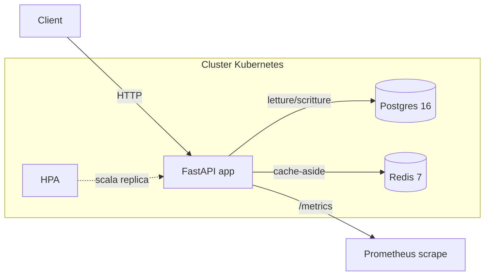

# mini-mvp — case study

Case study end-to-end di `mini-mvp`: API FastAPI per gestire note (CRUD),
con Postgres come fonte di verita' e Redis come cache cache-aside,
containerizzata e deployabile su Kubernetes.

## Architettura

Scritture (`POST`/`PUT`/`DELETE`) vanno sempre su Postgres per prime, poi
invalidano le chiavi Redis coinvolte. Letture (`GET`) controllano prima
Redis (TTL 120s): in caso di hit rispondono dalla cache, in caso di miss
leggono da Postgres e popolano la cache. Redis non e' mai la fonte di
verita'.

## Decision log

- **Postgres come fonte di verita'**: dati relazionali semplici (note con
  `id`, `title`, `content`, `created_at`), bisogno di garanzie
  transazionali e di uno schema versionato con Alembic. Nessun requisito
  che giustifichi un NoSQL.
- **Redis come cache cache-aside**: `GET /notes` e `GET /notes/{id}` sono
  il percorso piu' frequente; una cache con TTL riduce il carico su
  Postgres senza introdurre un secondo sistema con garanzie forti — i dati
  letti stale per al massimo 120s sono accettabili per delle note. Scelto
  sopra una cache in-process perche' deve sopravvivere al riavvio dei pod
  e restare condivisa tra le repliche.
- **Kubernetes per il deploy**: il carico di `GET /notes` e' variabile e
  l'HPA (`k8s/hpa.yaml`) permette di scalare orizzontalmente le repliche
  dell'API in base alla CPU senza intervento manuale. Postgres e Redis
  restano fuori dai manifest applicativi (gestiti come servizi managed o
  stateful set separati) per non reinventare la gestione dello storage
  persistente in cluster.

## File essenziali

| File | Scopo |
| --- | --- |
| [`Dockerfile`](../Dockerfile) | Build multi-stage: installa le dipendenze in uno stage, copia solo `app/`, `alembic/` e `alembic.ini` nello stage runtime, espone la porta 8000. |
| [`docker-compose.yml`](../docker-compose.yml) | Ambiente di sviluppo locale: servizi `api`, `postgres` (con volume persistente) e `redis`. |
| [`k8s/deployment.yaml`](../k8s/deployment.yaml) | Deployment con probe di readiness/liveness su `/health`, resource requests/limits e shutdown graceful. |
| [`k8s/service.yaml`](../k8s/service.yaml) | Service `ClusterIP` sulla porta 80 verso il container (8000). |
| [`k8s/configmap.yaml`](../k8s/configmap.yaml) | Variabili non sensibili (es. `REDIS_URL`). |
| [`k8s/secret.example.yaml`](../k8s/secret.example.yaml) | Placeholder per le variabili sensibili (`DATABASE_URL`, credenziali Postgres). |
| [`k8s/hpa.yaml`](../k8s/hpa.yaml) | Horizontal Pod Autoscaler basato sulla CPU (2-5 replica, target 70%). |
| [`.github/workflows/ci.yml`](../.github/workflows/ci.yml) | Workflow CI: riconosce lo stack Python e lancia `pytest`. |

## Costi e punti di failure

**Costi** (ordine di grandezza, variano per provider e regione):

- Un cluster Kubernetes managed (EKS/GKE) parte da qualche decina di
  euro/mese solo per il control plane, piu' il costo dei nodi worker.
- Postgres managed (es. RDS) e Redis managed (es. ElastiCache) hanno un
  costo aggiuntivo per istanza anche nella fascia piu' piccola; sono i
  componenti stateful piu' costosi da gestire rispetto all'API stateless.
- L'autoscaling (HPA) contiene i costi nei periodi di basso traffico ma
  puo' farli salire rapidamente sotto carico se i limiti massimi di
  replica non sono tarati.

**Punti di failure**:

- **Postgres non raggiungibile**: l'API non puo' servire scritture né
  letture in caso di cache miss; e' il single point of failure principale
  (mitigabile con replica/failover gestito dal provider managed).
- **Redis non raggiungibile**: degrada le performance (ogni `GET` finisce
  su Postgres) ma non la correttezza, perché Redis non e' mai la fonte di
  verita'; nei test si usa un fallback in-memory di processo.
- **Migrazioni Alembic non applicate**: l'app si avvia ma le query sulle
  tabelli mancanti falliscono; le migrazioni vanno eseguite manualmente
  dopo il deploy (`alembic upgrade head`), non c'e' un init container che
  lo automatizzi.
- **Secret non configurati**: `k8s/secret.example.yaml` e' solo un
  placeholder; senza un `secret.yaml` reale con `DATABASE_URL` valida il
  Deployment resta in crash loop.
